# Plan: Catálogo Interactivo de Empresas por Categorías, Pantallazos de Restaurantes y Retiro del Panel Admin

| Metadato | Detalle |
|---|---|
| **ID del Plan** | `0003` |
| **Fecha de Creación** | 2026-11-06 |
| **Estado** | `[x] Completado` |
| **ADR Relacionados** | [ADR-0001 (Commits Co-authored)](../adr/0001-commit-co-author.md), [ADR-0002 (Dark/Light & SEO)](../adr/0002-soporte-dark-light-mode-y-seo.md), [ADR-0003 (Planes y Tareas)](../adr/0003-planes-especificaciones-tareas-unificados.md) |
| **Autor/Líder** | Antigravity AI & jsdnlb |

---

## 1. Plan de Implementación

### 1.1 Contexto y Necesidad del Negocio
Actualmente, la plataforma cuenta con un panel administrativo (`/admin` y `/admin/login`) pensado para la gestión de proyectos y leads. Sin embargo, para agilizar la operación y el control comercial, se determina **prescindir del panel admin** y gestionar el catálogo de clientes y marcas directamente desde el código fuente y archivos de configuración estructurados.

Al mismo tiempo, los visitantes y clientes potenciales de EternalIA buscan comprobar de manera inmediata la calidad visual y técnica de las soluciones que implementamos. Es fundamental organizar las empresas con un enfoque especializado en **Restaurantes**, **Comidas Rápidas**, **Cafés/Repostería** y **Comercio/Servicios**, permitiendo a cualquier visitante:
1. Filtrar de forma intuitiva e inmediata por la categoría de su interés.
2. Explorar **pantallazos reales / mockups visuales** de las aplicaciones, menús QR y sistemas de pedidos implementados.
3. Abrir un visor tipo **Lightbox / Modal de Pantalla Completa** para examinar la interfaz y los flujos de conversión de cada cliente.
4. Conectar con un solo clic a la demo en vivo o solicitar una solución personalizada similar mediante el formulario de contacto ejecutivo.

### 1.2 Alcance y Arquitectura de la Solución

```mermaid
flowchart TD
    subgraph RetiroAdmin [Retiro del Panel Admin]
        A1[src/App.jsx] -->|Elimina rutas /admin y /admin/login| A2[Redirección a Home /]
        A3[Navbar, Footer, HeroTerminal] -->|Elimina enlaces y comandos admin| A4[Limpieza de UI pública]
    end

    subgraph DatosDirectos [Gestión Directa en Código]
        B1[src/data/projectsConfig.js] -->|Fuente única de verdad| B2[Categorías: Restaurantes, Comidas Rápidas, etc.]
        B3[public/screenshots/] -->|Assets gráficos y capturas| B1
    end

    subgraph UXCatalogo [Nuevo Catálogo Interactivo]
        C1[Filtros de Categoría] -->|Restaurantes, Comidas Rápidas, Cafés, Todos| C2[Grid de Tarjetas con Pantallazos]
        C2 -->|Click en Pantallazo / Ver Detalle| C3[Modal Lightbox de Alta Definición]
        C3 -->|Acciones| C4[Ver Demo en Vivo]
        C3 -->|Conversión| C5[Solicitar Solución Similar / ContactModal]
    end
```

### 1.3 Dependencias y Compatibilidad
- **Iconografía**: Utilización de iconos temáticos de `lucide-react` (`UtensilsCrossed`, `Pizza`, `Coffee`, `ShoppingBag`, `Sparkles`, `Maximize2`, `Eye`, `ArrowUpRight`).
- **Diseño Dual**: Estricto cumplimiento del **ADR-0002** (100% soporte Dark y Light Mode con contraste WCAG 2.1 AA).
- **Control de Versiones**: Estricto cumplimiento del **ADR-0001** (coautoría obligatoria en cada commit).

---

## 2. Especificaciones Técnicas y Funcionales

### 2.1 Especificaciones Funcionales
1. **Eliminación y Desacoplamiento de Rutas Admin**:
   - Eliminar las rutas `/admin` y `/admin/login` en `src/App.jsx`. Toda URL no reconocida será canalizada por el redireccionador catch-all hacia `/`.
   - Remover el botón "Consola / Clúster Admin" del Navbar (desktop y móvil).
   - Remover el enlace de administración en el Footer.
   - En el Hero Terminal (`HeroTerminal.jsx`), retirar el comando y sugerencia `admin`.
2. **Estructura de Datos del Catálogo (`projectsConfig.js`)**:
   - Cada entidad de cliente/empresa contendrá:
     - `id`: Identificador único.
     - `name`: Nombre comercial de la marca (ej. "La Trattoria Italiana", "Burger Station Gourmet", "Marinilla Express", "Armar Banquetes").
     - `category`: `'restaurants'` | `'fastfood'` | `'cafes'` | `'commerce'`.
     - `categoryLabel`: Etiqueta legible bilingüe (ES / EN).
     - `tagline`: Propuesta de valor o subtítulo atractivo.
     - `description`: Descripción concisa del sistema implementado (menú QR, pedidos WhatsApp, POS cloud, comanderos).
     - `screenshotUrl`: Imagen o captura principal del software/menú digital del restaurante.
     - `gallery`: Array de capturas secundarias (ej. vista móvil, checkout de pedidos, panel de despacho).
     - `techStack`: Tecnologías clave (React, Tailwind, WhatsApp API, Firebase, etc.).
     - `metricValue` y `metricLabel`: Impacto comercial (ej. "+3,500 pedidos/mes", "0% comisiones").
     - `url`: Enlace a la demo o sitio en vivo.
3. **Categorización Intuitiva**:
   - **✨ Todas las Marcas**: Vista global con contador dinámico de proyectos.
   - **🍽️ Restaurantes**: Cocina de autor, asaderos, gastronomía gourmet y mesas con menú QR interactivo.
   - **🍔 Comidas Rápidas**: Pizzerías, hamburgueserías, alitas, hot dogs y delivery express sin comisiones.
   - **☕ Cafés & Repostería**: Cafeterías de especialidad, pastelerías y reposterías artesanales.
   - **🛍️ Comercio & Empresas**: Redes comerciales, directorios y plataformas corporativas.
4. **Visor de Pantallazos (Lightbox Modal)**:
   - Las tarjetas de empresas contarán con un mockup de marco digital que exhibe el pantallazo con overlay de zoom.
   - Al hacer clic, se despliega un visor modal que permite:
     - Examinar el pantallazo a gran escala en alta nitidez.
     - Alternar entre capturas si la empresa cuenta con varias pantallas (menú, checkout, comanda).
     - Visualizar métricas de conversión y tecnologías implementadas.
     - Enlace directo a demo interactiva.
     - Botón de conversión directa: *"Quiero una plataforma como esta"* (abre `ContactModal`).

### 2.2 Especificaciones de Diseño Dark/Light Mode (ADR-0002)
- **Modo Claro (Light Mode)**:
  - Fondos de tarjetas: `bg-white/90` con bordes sutiles `border-zinc-200/80` y sombras difusas `shadow-lg shadow-zinc-200/50`.
  - Píldoras de categoría activas: Gradientes vivos con texto de alto contraste (`text-zinc-900`, `text-amber-900`, `text-indigo-900`).
  - Visor modal: Marco `bg-white` con `border-zinc-300`, texto `text-zinc-900`.
- **Modo Oscuro (Dark Mode)**:
  - Fondos de tarjetas: `bg-[#0e0f15]/90` o `glass-card` con bordes `border-white/10` y sombras `shadow-black/50`.
  - Visor modal: `bg-[#12131a]` con `border-white/15`, texto `text-white`.

---

## 3. Desglose de Tareas Accionables

### Fase 1: Desacoplamiento y Retiro del Módulo Admin
- [x] Tarea 1.1: Retirar las rutas `/admin` y `/admin/login` en `src/App.jsx` garantizando redirección segura al home `/`.
- [x] Tarea 1.2: Eliminar enlaces y botones hacia `/admin/login` en `src/components/Navbar.jsx`.
- [x] Tarea 1.3: Eliminar el enlace administrativo en `src/components/Footer.jsx`.
- [x] Tarea 1.4: Retirar el comando y badge `admin` en `src/components/HeroTerminal.jsx`.
- [x] Tarea 1.5: Simplificar `src/services/projectService.js` para usar directamente `src/data/projectsConfig.js` como fuente centralizada y desacoplada de sesiones admin.

### Fase 2: Configuración del Catálogo de Empresas y Pantallazos
- [x] Tarea 2.1: Crear la carpeta `public/screenshots/` con capturas de alta definición y mockups de interfaces para restaurantes y comidas rápidas.
- [x] Tarea 2.2: Actualizar `src/data/projectsConfig.js` reorganizando las categorías en **Restaurantes**, **Comidas Rápidas**, **Cafés & Repostería** y **Comercio/Servicios**, incorporando las rutas de pantallazos, métricas y detalles comerciales.

### Fase 3: Renovación de la Experiencia de Usuario (`ProjectsShowcase.jsx`)
- [x] Tarea 3.1: Actualizar la barra de filtros por categorías gastronómicas y comerciales con iconos representativos y diseño responsive.
- [x] Tarea 3.2: Rediseñar las tarjetas de empresas para incorporar el marco mockup de pantalla, badge de categoría y botón de vista rápida del pantallazo.
- [x] Tarea 3.3: Implementar el visualizador modal tipo Lightbox de pantallazos a pantalla completa con navegación entre capturas, métricas y botón de llamado a la acción hacia `ContactModal`.
- [x] Tarea 3.4: Verificar contraste y consistencia de estilos duales Dark / Light Mode (ADR-0002).

### Fase 4: Pruebas, Auditoría y Confirmación de Commits
- [x] Tarea 4.1: Ejecutar `npm run build` para validar ausencia de errores de compilación y enlaces rotos.
- [x] Tarea 4.2: Actualizar la tabla de planes en `plans/README.md`.
- [x] Tarea 4.3: Realizar commit siguiendo el formato de ADR-0001 con coautor `jsdnlb <jsdnlb@users.noreply.github.com>`.

