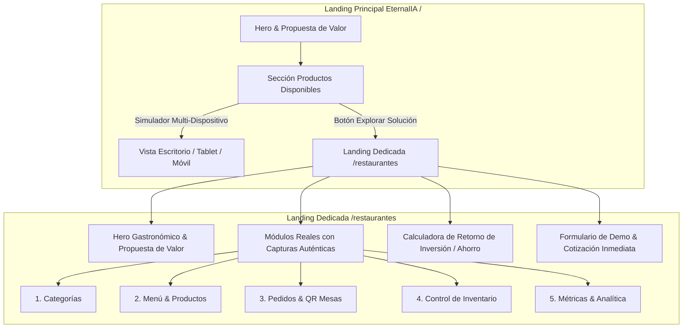

# Plan: Landing Dedicada para Software de Restaurantes y Módulo de Productos Responsive en Landing Principal

| Metadato | Detalle |
|---|---|
| **ID del Plan** | `0004` |
| **Fecha de Creación** | 2026-11-06 |
| **Estado** | `[x] Completado` |
| **ADR Relacionados** | [ADR-0001 (Commits Co-authored)](../adr/0001-commit-co-author.md), [ADR-0002 (Dark/Light & SEO)](../adr/0002-soporte-dark-light-mode-y-seo.md), [ADR-0003 (Planes y Tareas)](../adr/0003-planes-especificaciones-tareas-unificados.md) |
| **Autor/Líder** | Antigravity AI & jsdnlb |

---

## 1. Plan de Implementación

### 1.1 Contexto y Necesidad del Negocio
EternalIA ya cuenta con plataformas operativas reales para el sector gastronómico. El usuario ha suministrado las capturas reales del sistema en producción que incluye 5 módulos neurálgicos:
1. **Categorías del Menú** (Sopas, Menús del día, Platos fuertes, Fritos, Adiciones, Bebidas).
2. **Productos & Menú Digital** (Fotos, precios en COP, control de disponibilidad y estrellas).
3. **Control de Pedidos & Comandas** (Domicilio, Para recoger, En mesa con código QR, estados, impresión y WhatsApp).
4. **Control de Inventario** (Stock disponible, valor del inventario, alertas de agotado y habilitación de stock).
5. **Métricas & Analítica en Tiempo Real** (Ventas mensuales, ticket promedio, horas pico, productos top y exportación CSV).

Para maximizar la conversión y credibilidad:
- Se requiere una **landing page independiente y dedicada** (`/restaurantes`), enfocada 100% en vender y demostrar este software a dueños de restaurantes, cafeterías y negocios de comidas rápidas.
- En la **landing principal de Eternalia** (`/`), debe crearse un apartado destacado de **"Productos Disponibles"** que exhiba este software con un selector interactivo multi-dispositivo (**Escritorio**, **Tablet**, **Móvil**) que demuestre que la solución es 100% responsive, enlazando directamente a la landing dedicada.

### 1.2 Arquitectura y Flujo de la Solución

### 1.3 Almacenamiento de Assets
Las capturas suministradas por el usuario han sido organizadas en:
- `public/products/restaurants/categorias.jpg`
- `public/products/restaurants/productos.jpg`
- `public/products/restaurants/pedidos.jpg`
- `public/products/restaurants/inventario.png`
- `public/products/restaurants/metricas.jpg`

---

## 2. Especificaciones Técnicas y Funcionales

### 2.1 Especificaciones de la Landing Dedicada (`/restaurantes`)
1. **Ruta y Navegación**:
   - URL canónica: `/restaurantes` (con soporte en `App.jsx`).
   - Navbar adaptado con botón para volver a EternalIA Corporativo y CTA principal "Solicitar Demo de Restaurante".
2. **Hero Impactante**:
   - Título enfocado en la rentabilidad gastronómica: *"El Sistema Operativo Definitivo para tu Restaurante: Cero Comisiones, Comandas a Cocina y Menú QR"*.
   - Selector interactivo de dispositivos (Mockup Desktop 16:9, Tablet 4:3, Smartphone 9:16) con cambio fluido.
3. **Showcase Interactivo de Módulos Reales**:
   - Pestañas interactivas de los 5 módulos reales con sus capturas oficiales:
     - **Módulo 1: Categorización Inteligente**: Ordena tus platos, desactiva ingredientes agotados en segundos y gestiona turnos de menú del día.
     - **Módulo 2: Menú Digital & Precios**: Fichas visuales con fotos reales, precios en tiempo real y selector de destacados.
     - **Módulo 3: Comandero y Pedidos Multicanal**: Integración de mesas (QR), domicilios y pedidos para recoger con despacho directo a WhatsApp e impresora térmica.
     - **Módulo 4: Control de Inventario**: Supervisa existencias críticas, alertas de stock mínimo y valorización automática del inventario.
     - **Módulo 5: Dashboard de Métricas y Ventas**: Conoce tus platos estrella (ej. Rosada Mexicana), tus horas pico de mayor facturación y el ticket promedio diario.
4. **Calculadora de Ahorro frente a Apps de Domicilios (Rappi/iFood)**:
   - Comparador interactivo: muestra cuánto dinero ahorra un restaurante al mes facturando directamente en su propio software sin pagar del 20% al 30% de comisiones por intermediación.
5. **Conversión**:
   - Botón directo hacia el `ContactModal` preconfigurado con el tipo de negocio seleccionado (Restaurante, Comidas Rápidas, Cafetería).

### 2.2 Especificaciones del Módulo en la Landing Principal (`PublicLanding.jsx`)
1. **Sección "Productos Disponibles"**:
   - Tarjeta destacada tipo producto SaaS con badge *"Software Disponible Ahora"*.
   - Simulador de pantalla responsive interactivo: botones para alternar vista **Escritorio (Monitor)**, **Tablet (iPad de Comandas)** y **Móvil (Mesero / Comensal)**.
   - Enlace directo con botón llamativo: *"Explorar Landing Completa de Restaurantes →"*.

### 2.3 Reglas de Diseño y Accesibilidad (ADR-0002)
- Modo Oscuro y Modo Claro 100% soportados con contrastes WCAG 2.1 AA en textos, tarjetas, bordes y botones.
- Metadatos SEO completos: Title, Meta Description, OpenGraph y Schema.org `SoftwareApplication` para software gastronómico.

---

## 3. Desglose de Tareas Accionables

### Fase 1: Organización de Assets y Configuración de Rutas
- [x] Tarea 1.1: Confirmar almacenamiento y optimización de las 5 capturas en `public/products/restaurants/`.
- [x] Tarea 1.2: Configurar la ruta `/restaurantes` en `src/App.jsx` vinculada al componente de la nueva página.

### Fase 2: Creación de la Landing Dedicada (`src/pages/RestaurantLanding.jsx`)
- [x] Tarea 2.1: Construir el Hero con selector de dispositivos interactivo (Escritorio, Tablet, Móvil).
- [x] Tarea 2.2: Implementar el explorador de los 5 módulos reales con las capturas auténticas proporcionadas.
- [x] Tarea 2.3: Añadir la calculadora de ahorro de comisiones (0% vs 25% de terceros).
- [x] Tarea 2.4: Integrar Navbar y Footer adaptados con cambio bilingüe y Dark/Light Mode (ADR-0002).
- [x] Tarea 2.5: Integrar el formulario de contacto para cotizaciones y demos gastronómicas.

### Fase 3: Integración de "Productos Disponibles" en la Landing Principal
- [x] Tarea 3.1: Crear el componente `src/components/FeaturedProducts.jsx` con el simulador responsive multi-pantalla.
- [x] Tarea 3.2: Integrar la sección en `src/pages/PublicLanding.jsx` en una posición estratégica y atractiva.
- [x] Tarea 3.3: Actualizar los enlaces en el Navbar y menú de navegación para acceder a `/restaurantes`.

### Fase 4: Auditoría SEO, Pruebas y Commit
- [x] Tarea 4.1: Ejecutar `npm run build` para garantizar cero errores de TypeScript/Vite y validar empaquetado.
- [x] Tarea 4.2: Actualizar la tabla de planes en `plans/README.md`.
- [x] Tarea 4.3: Realizar commit siguiendo el formato de ADR-0001 con coautor `jsdnlb <jsdnlb@users.noreply.github.com>`.
