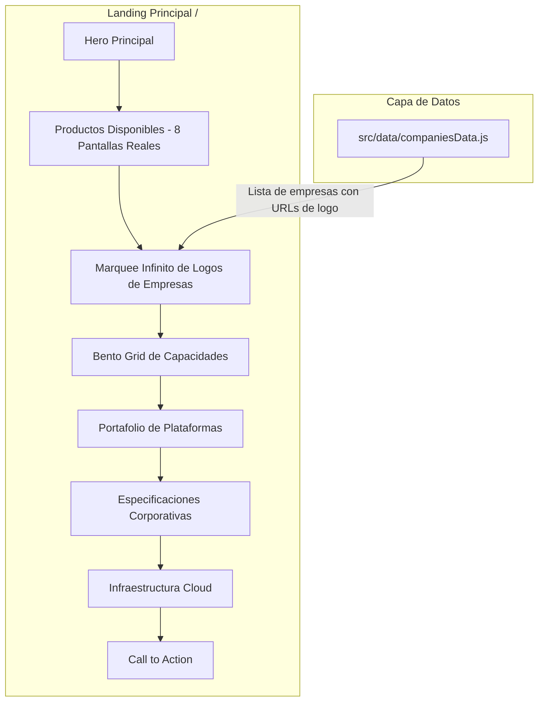

# Plan: Retiro de Cotizador y Directorio + Marquee Infinito de Logos de Empresas

| Metadato | Detalle |
|---|---|
| **ID del Plan** | `0005` |
| **Fecha de Creación** | 2026-11-06 |
| **Estado** | `[x] Completado` |
| **ADR Relacionados** | [ADR-0001 (Commits Co-authored)](../adr/0001-commit-co-author.md), [ADR-0002 (Dark/Light & SEO)](../adr/0002-soporte-dark-light-mode-y-seo.md), [ADR-0003 (Planes y Tareas)](../adr/0003-planes-especificaciones-tareas-unificados.md) |
| **Autor/Líder** | Antigravity AI & jsdnlb |

---

## 1. Plan de Implementación

### 1.1 Contexto y Requerimiento
El usuario solicitó remover dos secciones de la landing principal:
1. **Cotizador Interactivo de Soluciones** (`QuoteEngine.jsx`).
2. **Red de Conectividad Comercial Inteligente / Directorio** (`DirectoryDemo.jsx`).

En su lugar, solicitó crear un **Marquee interactivo infinito con los logos de las empresas clientes / aliadas** que cuente con soporte directo para URLs de logos (`logo: "https://..."` o rutas locales), nombres comerciales, categorías y enlaces a las plataformas en vivo de cada empresa.

### 1.2 Arquitectura y Componentes


### 1.3 Características del Marquee
- **Animación Continua**: Animación CSS suave tipo cinta infinita que se desplaza de derecha a izquierda (y fila opuesta si aplica).
- **Pausa al Interactuar**: Al colocar el cursor (`hover`) o tocar en móvil, la animación se detiene suavemente para permitir la lectura y clic.
- **Soporte de URL de Logos**: Si la empresa tiene `logo: "https://..."` o `/logos/...`, se renderiza la imagen del logo en alta resolución; si aún no tiene URL cargada o falla, muestra un monograma tipográfico con degradado corporativo moderno.
- **Enlaces a Plataformas**: Cada tarjeta de empresa enlaza a su URL oficial o subdominio en vivo.
- **Dark & Light Mode (ADR-0002)**: Contraste WCAG 2.1 AA con tarjetas en vidrio oscuro (`glass-panel`) en Dark Mode y fondo blanco pulido con sombras suaves en Light Mode.

---

## 2. Especificaciones Técnicas y Funcionales

### 2.1 Estructura del Objeto Empresa (`companiesData.js`)
```typescript
interface CompanyItem {
  id: string;
  name: string;
  logo: string | null; // URL del logo (ej: "https://..." o "/logos/empresa.png")
  url: string;        // URL web o plataforma en vivo
  categoryEs: string; // Ej: "Restaurante & Parrilla"
  categoryEn: string;
  taglineEs: string;  // Ej: "Menú Digital QR & Pedidos WhatsApp"
  taglineEn: string;
  logoColor?: string; // Gradiente de respaldo si no hay imagen de logo
}
```

### 2.2 Retiro de Dependencias Innecesarias en `PublicLanding.jsx`
- Eliminar imports y renderizado de `QuoteEngine` y `DirectoryDemo`.
- Limpiar rutas de navegación rápida en `Navbar.jsx` y `Hero.jsx` que apuntaban a `#cotizador` y `#directorio`.

---

## 3. Desglose de Tareas Accionables

- [x] **Tarea 1**: Crear archivo de datos centralizado [`src/data/companiesData.js`](file:///home/victor/Escritorio/EternalIA/src/data/companiesData.js) con listado estructurado de empresas, sus URLs de logo configurables, subdominios y categorías.
- [x] **Tarea 2**: Configurar animaciones de marquee (`@keyframes marquee`) en CSS / Tailwind.
- [x] **Tarea 3**: Crear componente [`src/components/CompanyMarquee.jsx`](file:///home/victor/Escritorio/EternalIA/src/components/CompanyMarquee.jsx) con doble fila infinita, pausa en hover, máscaras de desvanecimiento lateral y compatibilidad Dark/Light mode.
- [x] **Tarea 4**: Retirar `<QuoteEngine />` y `<DirectoryDemo />` de [`src/pages/PublicLanding.jsx`](file:///home/victor/Escritorio/EternalIA/src/pages/PublicLanding.jsx) e insertar `<CompanyMarquee />`.
- [x] **Tarea 5**: Actualizar botones de navegación en [`Navbar.jsx`](file:///home/victor/Escritorio/EternalIA/src/components/Navbar.jsx) y [`Hero.jsx`](file:///home/victor/Escritorio/EternalIA/src/components/Hero.jsx) para enlazar a `#empresas`.
- [x] **Tarea 6**: Validar `npm run lint` y `npm run build` sin errores.
- [x] **Tarea 7**: Realizar commit bajo ADR-0001 con coautoría obligatoria.
